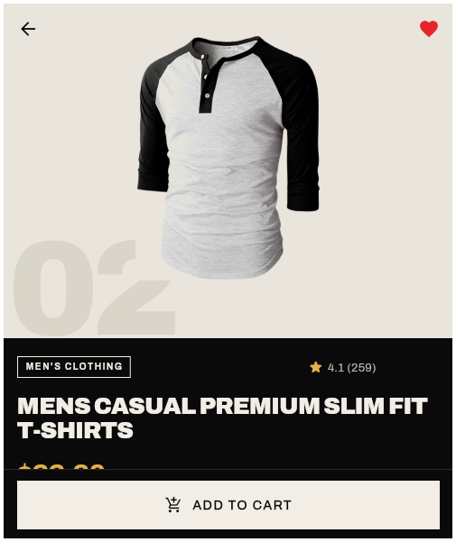
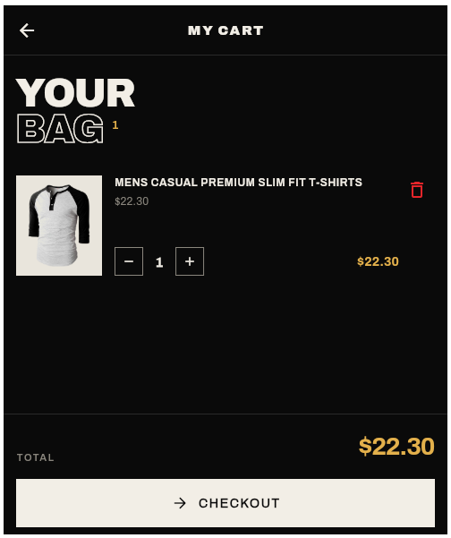
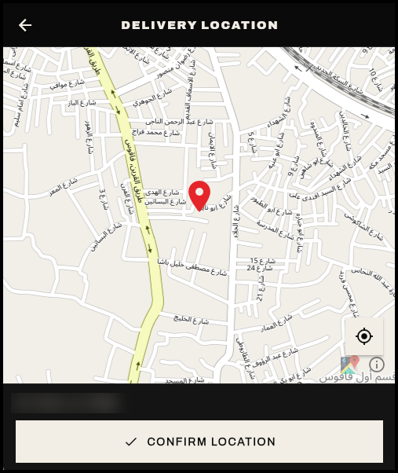
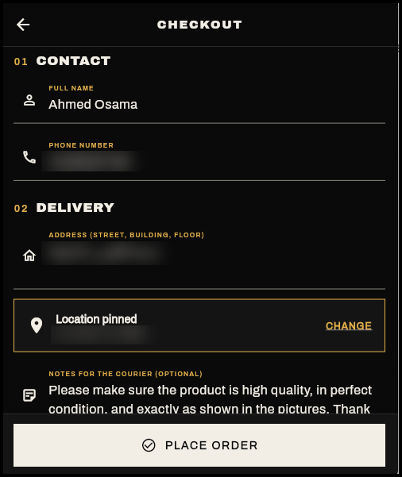
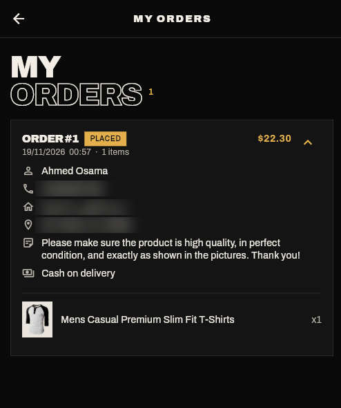

# Event Store

A Flutter store app for customers: browse products, save favorites, fill a cart, enter delivery details, pin the delivery location on a map and place an order.

Built with **Cubit / Bloc (`flutter_bloc`)** and a **feature-first clean architecture** (domain / data / presentation). It runs on **Android, iOS and Web** from one codebase.

The **admin side** (add, edit and delete products, view orders) is done through **Postman**, not inside the app.

<p align="center">
  
</p>

## Screenshots

| Home | Details | Cart |
|:----:|:-------:|:----:|
|  |  |  |

| Delivery location | Checkout | My orders |
|:-----------------:|:--------:|:---------:|
|  |  |  |

## Customer Features

- Product grid fetched from the [Fake Store API](https://fakestoreapi.com/)
- Search by name and filter by category
- Favorites: tap the heart on any product, then filter by "Favorites"
- Product details page
- Cart with quantity controls and total
- Checkout: name, phone (Egyptian mobile format), address, courier notes, with validation
- Delivery location picked on an OpenStreetMap map, with a "locate me" button (device GPS) and reverse geocoding to an address
- Payment: cash on delivery
- Place order (`POST /carts`) and view "My Orders" with the delivery details
- Loading skeletons, error handling with retry, and timeout handling

## Engineering Highlights

- **Clean architecture, feature-first:** `presentation -> domain <- data`, with a domain layer that is pure Dart (no Flutter, `http` or map imports)
- **One class per file**, every file named after its class, with no repeated code
- **One source of truth for colors:** change a value in `app_colors.dart` and the whole app follows
- **Reusable core widgets:** `PrimaryButton`, `SurfaceCard`, `BottomActionBar`, `ShimmerBox`, `StateMessage` and more
- **Typed error handling:** every failure (network, timeout, server, validation, location) is its own `Failure` class with a user-safe message
- **Smart checkout validation:** Egyptian mobile numbers are accepted as `01xxxxxxxxx`, `+201xxxxxxxxx` or `00201xxxxxxxxx` and normalized
- **Location done right:** handles GPS turned off, permission denied and permission blocked, with clear messages and a 15-second timeout
- **Request timeouts and retry:** a single `ApiClient` with a timeout, and a retry button when a load fails
- **Smooth UI:** shimmer skeletons while loading, fade-slide animations, and a bold dark design with outlined headings
- **Backend-ready:** orders go through a single data source (`OrdersRemoteDataSourceImpl`). Plug in your own backend and nothing else in the app has to change
- **Cross-platform:** one codebase for Android, iOS and Web

## Admin (Postman)

Products and orders are managed from Postman against the Fake Store API (`{{baseUrl}}` = `https://fakestoreapi.com`):

- **Admin - Products:** `GET /products`, `GET /products/{id}`, `GET /products/categories`, `POST /products`, `PUT /products/{id}`, `DELETE /products/{id}`
- **Orders (Carts):** `GET /carts`, `GET /carts/{id}`, `POST /carts` (the same body the app sends, including customer data and map location), `PUT /carts/{id}`, `DELETE /carts/{id}`

## Architecture

Feature-first clean architecture. **One class per file**, and every file name is the snake_case of the class inside it.

```
lib/
├── main.dart
├── app/                          # composition root
│   ├── app.dart                  # MaterialApp + BlocProviders
│   ├── dependencies.dart         # wires data -> domain (manual DI)
│   ├── router.dart
│   └── not_found_page.dart
├── core/                         # shared, feature-independent
│   ├── constants/                # api, map, geocoding, routes, layout
│   ├── error/                    # exceptions, one file per Failure, mapper
│   ├── network/                  # ApiClient (http)
│   ├── theme/
│   │   ├── app_colors.dart       # <- THE ONLY FILE WITH COLORS
│   │   ├── app_text_styles.dart
│   │   └── app_theme.dart
│   ├── utils/                    # format, text utils, validators
│   └── widgets/                  # PrimaryButton, SurfaceCard, BottomActionBar...
└── features/
    ├── products/   (domain | data | presentation: bloc, cubit, pages, widgets)
    ├── favorites/  (presentation: cubit)
    ├── cart/       (domain | presentation: cubit, pages, widgets)
    └── orders/     (domain | data | presentation: bloc, cubit, pages, widgets)
```

**Dependency rule:** `presentation -> domain <- data`. The domain layer (entities, repository interfaces, use cases) imports nothing from Flutter, `http` or any map package. Errors travel as `Failure` objects whose messages are safe to show to the user.

### State management

| Where | Type | Why |
|-------|------|-----|
| `ProductsBloc` (event: `ProductsLoadRequested`) | **Bloc** | loading products is an event-driven async flow |
| `OrdersBloc` (event: `OrderSubmitted`) | **Bloc** | placing an order is an event-driven async flow |
| `ProductsFilterCubit` | Cubit | search text, category, favorites filter |
| `CartCubit` | Cubit | add / remove / quantity |
| `FavoritesCubit` | Cubit | toggle favorite |
| `CheckoutFormCubit` | Cubit | checkout form fields + validation (page scoped) |
| `LocationPickerCubit` | Cubit | the pin on the map (page scoped) |

Screens never use `setState`: all screen state lives in Cubits and Blocs. Only two small widgets keep local UI state (the map controller and the shimmer animation).

### Colors

Every color is a `static const` in `lib/core/theme/app_colors.dart`. Change a value there and the whole app changes. No other file contains `Color(...)` or `Colors.x`.

## Tech Stack & Tools

| Area | Tool |
|------|------|
| Framework | Flutter & Dart 3 |
| State management | `flutter_bloc` (Bloc + Cubit), `equatable` |
| Networking | `http` |
| Map | `flutter_map` + `latlong2` (OpenStreetMap tiles, no API key) |
| Device location | `geolocator` |
| Reverse geocoding | OpenStreetMap Nominatim |
| Fonts / icons | `google_fonts`, `font_awesome_flutter` |
| Backend | [Fake Store API](https://fakestoreapi.com/) |
| API testing / admin | Postman |
| Lints | `flutter_lints` |
| Editor | Android Studio |

## Getting Started

```bash
git clone https://github.com/ahmedosamamohame/event-store-app.git
cd event-store-app
flutter create . --platforms=android,ios,web   # generates the platform folders
flutter pub get
flutter run -d chrome      # or: flutter run   (connected device / emulator)
```

If you copy the `lib/` folder into your own project instead, add the packages with:

```bash
flutter pub add flutter_bloc equatable flutter_map latlong2 http font_awesome_flutter google_fonts geolocator
```

## Platform Setup

The app talks to the internet (API, map tiles) and reads the device location, so each platform needs a few permissions.

**Android** (`android/app/src/main/AndroidManifest.xml`, inside `<manifest>`):

```xml
<uses-permission android:name="android.permission.INTERNET"/>
<uses-permission android:name="android.permission.ACCESS_COARSE_LOCATION"/>
<uses-permission android:name="android.permission.ACCESS_FINE_LOCATION"/>
```

**iOS** (`ios/Runner/Info.plist`):

```xml
<key>NSLocationWhenInUseUsageDescription</key>
<string>Your location is used to pin the delivery address on the map.</string>
```

**Web:** no extra setup. The browser asks for location permission, and location only works on `localhost` or `https`. (Nominatim's custom User-Agent header cannot be set from the browser, which is expected.)

Set your real application id in `lib/core/constants/map_constants.dart` (`userAgentPackage`). OpenStreetMap asks apps to identify themselves.

## Author

**Ahmed Elshakoushy**  
GitHub: [@ahmedosamamohame](https://github.com/ahmedosamamohame)  
LinkedIn: [Ahmed Osama](https://www.linkedin.com/in/ahmed-osama-816069399/)
